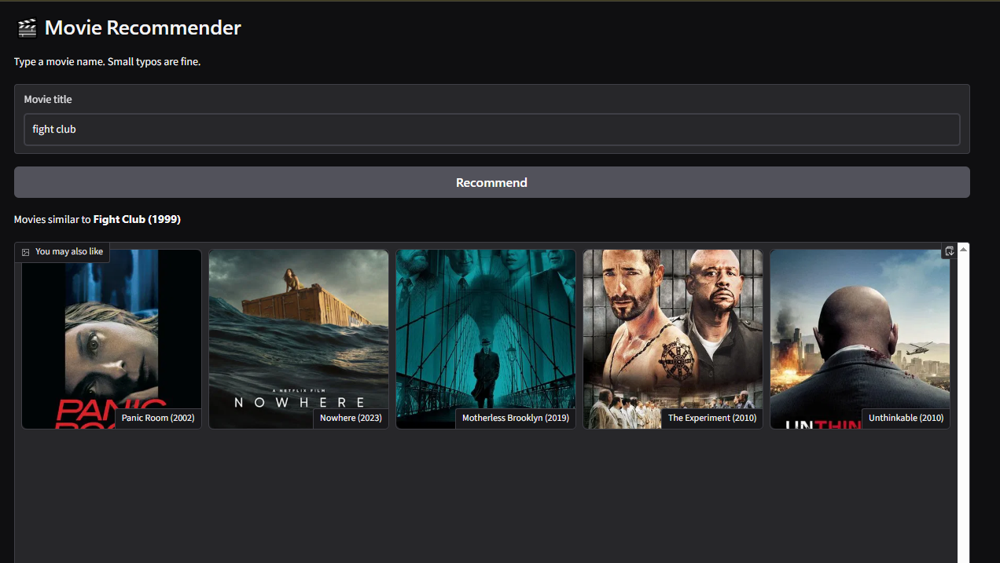

# Movie Recommendation System

Pick any movie and get 5 similar movies back. The movie database is built
from the TMDB API (not a ready-made CSV) and stored in SQLite.

**Tools:** Python, Requests (REST API), SQLite, Pandas, Scikit-learn, TF-IDF, Gradio

## How it works
1. A script calls the TMDB API, parses the JSON, and stores title, year,
   genres, plot, top 5 cast, director, rating and poster in a SQLite database.
2. The data is checked for missing fields. Records with a missing or very
   short plot would be dropped; missing cast, director or genres are filled
   with empty text.
3. Plot, genres, cast and director each get their own TF-IDF vectors, which
   are weighted and joined, then compared with cosine similarity.
4. `recommend()` finds the movie (case-insensitive, with fuzzy matching for
   typos) and returns the 5 highest-scoring neighbours.
5. A small Gradio web page shows the 5 recommendations with posters.

## Results
- Database size: **5,000 movies** (the 5,000 most-voted movies on TMDB)
- Average time per recommendation: **about 0.002 seconds** (measured over
  20 runs in Colab; the similarity matrix is computed once, so each
  recommendation is only a lookup and a sort)

| Movie | Top 5 recommendations |
|---|---|
| The Dark Knight | The Dark Knight Rises · Batman Begins · Insomnia · The Man from Nowhere · District 13: Ultimatum |
| Toy Story | Toy Story 2 · A Bug's Life · Cars · Cars 2 · Toy Story That Time Forgot |
| The Godfather | The Godfather Part II · The Outsiders · The Godfather Part III · Extremely Wicked, Shockingly Evil and Vile · The Unforgivable |
| Inception | The Dark Knight Rises · Tenet · Batman Begins · Demolition Man · Code 8 |
| Titanic | Desire · The Room · Below Her Mouth · Life in a Year · Notes on a Scandal |

## Challenges and fixes
- **API limits and incomplete records:** all requests go through one
  function that retries with exponential backoff (1, 2, 4, 8, 16 seconds) on
  429 and server errors, and caches every response on disk so nothing is
  fetched twice. A data check found only 5 incomplete records out of 5,000
  (4 without cast, 1 without a poster), so no movies had to be dropped.
- **Typos and sequel-heavy results:** added case-insensitive and fuzzy
  title matching (for example, "dark knigt" finds The Dark Knight). My first
  version mixed everything into one text, so sequels dominated. I gave plot,
  genre, cast and director their own weights
  (**plot 1.0, genre 1.5, cast 0.5, director 1.0**), tested a stronger
  genre/director version too, and chose by reading the results on sample
  movies.

| Movie | Before (one mixed text) | After (separate weights) |
|---|---|---|
| The Dark Knight | The Dark Knight Rises · Batman Begins · Batman · Batman Forever · Batman: The Killing Joke | The Dark Knight Rises · Batman Begins · Insomnia · The Man from Nowhere · District 13: Ultimatum |
| Toy Story | Toy Story 3 · Toy Story 2 · Toy Story 4 · The 40 Year-Old Virgin · Toy Story 5 | Toy Story 2 · A Bug's Life · Cars · Cars 2 · Toy Story That Time Forgot |

## Limitations
- Weights were tuned by eye, not measured with an accuracy score, so there
  is no accuracy number for this project.
- Some recommendations are weak, for example the Titanic row above.
- Only 5,000 popular movies are included, picked by vote count.
- Recommendations use text and metadata only, not user ratings.

## Run it
1. Get a free API key from themoviedb.org.
2. Open `movie_recommender.ipynb` in Google Colab.
3. Add your key as a Colab Secret named `TMDB_API_KEY`.
4. Run all cells. The last cell starts the Gradio page.

This product uses the TMDB API but is not endorsed or certified by TMDB.